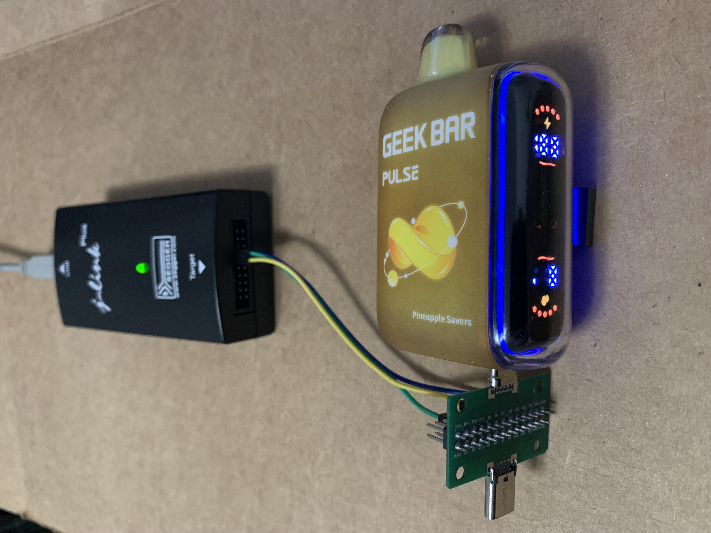
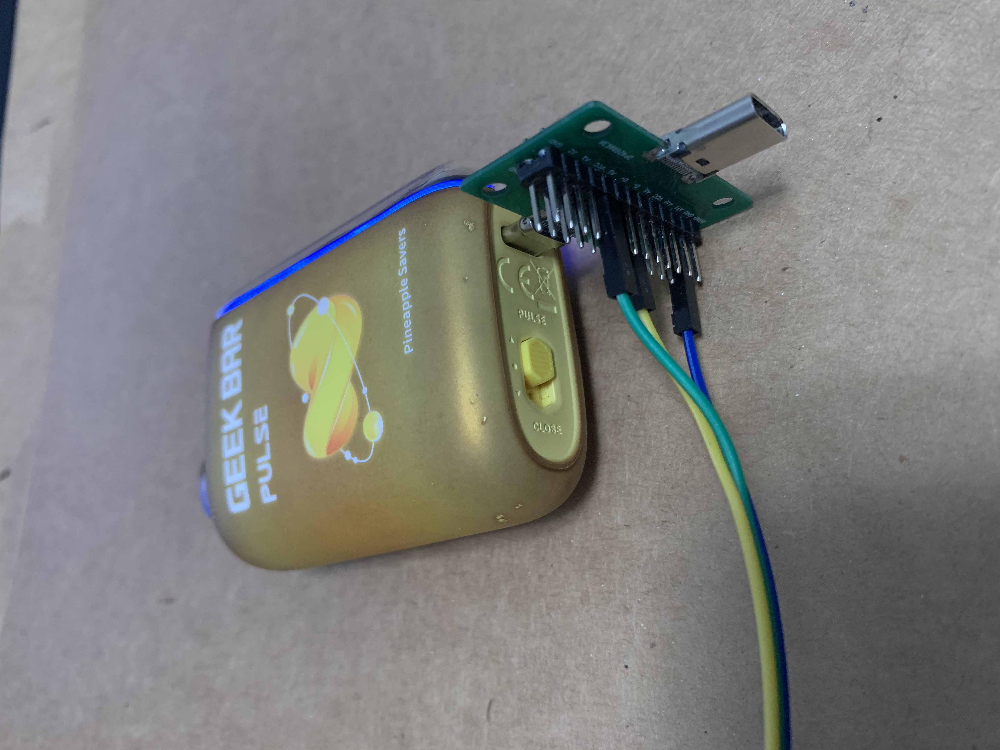
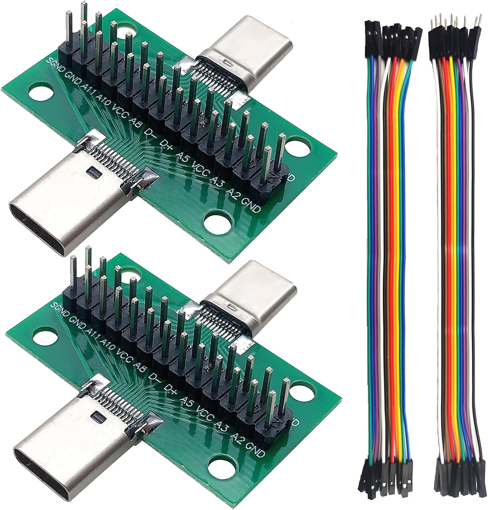

# Geek Bar Pulse Hardware/Firmware Hack
Hijack/repurpose of Geek Bar Pulse Puya PY32F030K28 Cortex-M0

Description: Reverse engineering and repurposing of Geek Bar Pulse assets (MCU, LED display, USB-C charging, Lithium Ion battery)

## Hardware:
- MCU:
	- Puya PY32f030EK28 Cortex-M0
	- 64k Flash, 8k SRAM, 32-QFN 5x5 package
	- https://www.py32.org/en/mcu/PY32F030xx.html
- 53-LED multiplexed display
- 16 perimeter RGB LEDs
- LP4068 800 mA single-chip linear charger for single-cell Li-ion battery
- USB-C charging port (5.1k pull-downs on CC1/CC2 for USB-C PD)
	- SWD interface (SWDIO, SWCLK) routed to CC1, CC2 for external flash programming

## SDK/IDE:
- Puya PY32F0xx_Firmware-master SDK
	- HAL/LL drivers, code examples, device templates, start-up files
		- https://github.com/OpenPuya/PY32F0xx_Firmware
- Keil MDK-ARM v5.43a uVision 5 IDE
	- Puya microcontrollers natively supported in latest version
	- Pack Installer selection - PY32F0 Series (Puya::PY32F0x_DFP)
	- Run Time Environment (RTE) setup:
		- Select CMSIS Core
		- Don't select the Device Startup checkbox ... Puya's SDK erroneously loads the PY32F031 startup file along with PY32F030 which causes compiler errors
		- Manually copy and add the correct startup and system files to project:
			- PY32F0xx_Firmware-master\Drivers\CMSIS\Device\PY32F0xx\Source\arm\startup_py32f030x8.s
			- PY32F0xx_Firmware-master\Drivers\CMSIS\Device\PY32F0xx\Source\system_py32f0xx.c
- PY32F0xx_HAL_Driver folder:
	- Files copied from downloaded SDK to uVision project directory and added to project
- Template files added to project folder and project:
	- PY32F0xx_Firmware-master\Templates\PY32F030xx_Templates\Src:
		- main.c, py32f0xx_hal_msp.c, py32f0xx_it.c
	- PY32F0xx_Firmware-master\Templates\PY32F030xx_Templates\Inc:
		- main.h, py32f0xx_hal_conf.h, py32f0xx_it.h
- Options for Target_1:
	- Device - PY32F030x8
	- Software Pack - Puya::PY32F0xx_DFP@1.2.8
	- C/C++ tab:
		- Defines: USE_HAL_DRIVER, PY32F030x8
			- Device aliases defined in PY32F0xx_Firmware-master\Drivers\CMSIS\Device\PY32F0xx\Include\py32f0xx.h
			- HAL defines in PY32F0xx_Firmware-master\Drivers\PY32F0xx_HAL_Driver\Inc\py32f0xx_hal_def.h
		- Include paths:
			- .\Core\Inc
			- C:\PY32F0xx_Firmware-master\Drivers\PY32F0xx_HAL_Driver\Inc
	- Debug:
		- J-LINK / J-TRACE Cortex
			- SWD, 5MHz (lower if difficulty connecting to target)
			- Flash download tab:
				- Check box "Reset and Run"
- Debug probes:
	- Segger J-Link Plus + Segger J-Link Commander v9.78, J-Flash v9.78
		- Closely integrated with Keil uVision (works reliably for programming and debug)
		- VTRef voltage of target inaccessible on sealed unit:
			- PY32f030EK28 runs directly from battery which varies from ~3.3-4.2
			- Either connect an external 3.3V supply to VTRef or use J-Link Commander to set VTRef:
				- Syntax - VTREF <Value[mV]>
					- Set fixed value for VTref on J-Link (0 == Auto detection).
					- Value[mV]	Value, VTref is supposed to be set to in millivolt.
				- Example --> VTREF 3300
	- ST-Linkv2 (not tested or used)
	- RP2040 Pi Pico (debugprobe_on_pico.uf2) + OpenOCD
		- https://github.com/raspberrypi/debugprobe/releases
		- https://www.visualmicro.com/page/Creating-a-Raspberry-Pi-Debug-Probe-(CMSIS-DAP).aspx
	

## Wiring:

- SWD interface exposed on USB-C charging port (CC1/CC2)
	- USB Type-C breakout board provides debugger access:
	- SWDIO - PA13, SWCLK - PA14 (A5 / B5 on breakout)
		- https://www.amazon.com/clp/B0BWXKV8DB
		- 
	- USB-C is reversible so A5 / B5 can be swapped to match SWD lines
- NOTE -> Normal state of unit is in deep sleep (or stop), SWD interface is normally unavailable. Slide switch wakes unit and provides small connect window. Can also plug in charger to wake unit and open another connect window/opportunity.
- See schematic for feature element mapping (i.e. RGB LEDs, display, etc)
	- https://github.com/schlae/VapeRE/tree/main/BD0027
- Perimeter RGB LEDs (16 tri-color smt LEDs, each color driven by FET):
	- Red - PA5
	- Green - PA4
	- Blue - PA2
- Charging indicator from LP4068 Li-Ion controller - PF1
- Charge current programming output - PF0
- Slide switch - PA7 (pulls low in one position, high in remaining two)
- LED matrix (53 display elements/LEDs)
	- 7 x 8 matrix
	- Refer to leds.h for mapping
- MOSFET coil drives
	- TB1 - PA1, Sense input PA6
	- TB2 - PA0, Sense input PA3
- Microphone (puff sensor) input - PF3

## Peripheral setup:
- LED matrix timer - TIM16 (auto-reload mode, 1.6 ms interrupt)
- Low power timer - LPTIM (? interrupt)
- RGB LED PWM:
	- Red   (PA5) TIM3_CH2 (AF13)
	- Green (PA4) TIM3_CH3 (AF13)
	- Blue  (PA2) TIM3_CH1 (AF13)
- TB1/TB2 PWM (MOSFET coil drives):
	- TB1 (PA1) TIM1_CH4 (AF13)
	- TB2 (PA0) TIM1_CH3 (AF13)
- Program/Debug - SWD ... PA13 (SWDIO)/PA14 (SWDCK)
- UART - USART1 ... re-purpose SWD via AF registers:
	- Rx = PA13 (AF8), Tx = PA14 (AF1)

 
